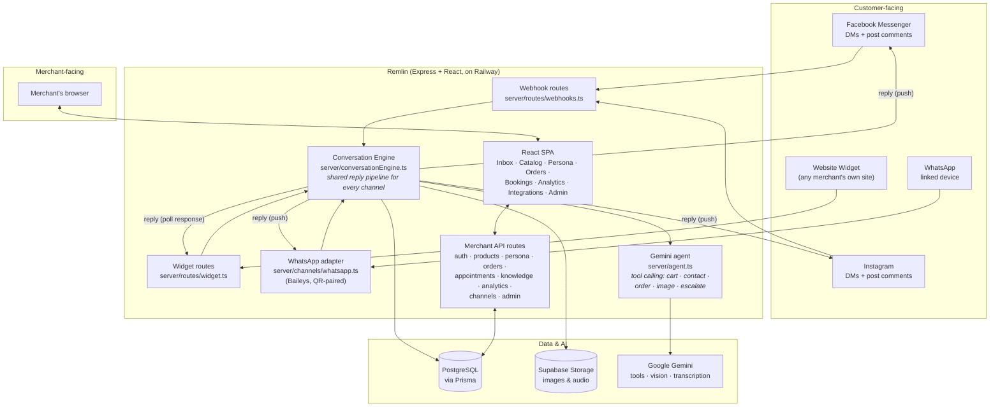
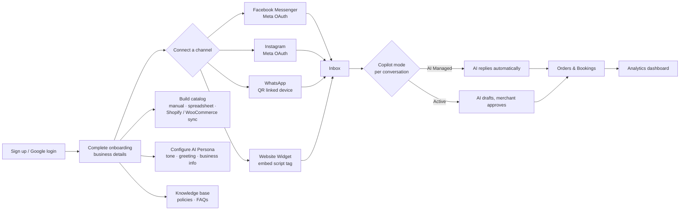

# Remlin

An AI sales agent for merchants — connects to Messenger, Instagram, WhatsApp, and a
website chat widget, answers customers using a real product catalog and knowledge
base, and manages carts, orders, and bookings end to end. Built as a CSE499
capstone project.

## Live Site

The deployed app is live on Railway: [remlin.up.railway.app](https://remlin.up.railway.app)

## Tech Stack

- **Frontend:** React 19 + TypeScript, Vite, Tailwind CSS 4
- **Backend:** Node.js + Express, TypeScript
- **Database:** PostgreSQL (Supabase) via Prisma ORM
- **Media storage:** Supabase Storage (product images, chat photos, voice notes)
- **AI:** Google Gemini — tool calling, image recognition, audio transcription
- **Messaging:** Meta Graph API (Messenger + Instagram), Baileys (WhatsApp linked device)
- **Catalog sync:** Shopify, WooCommerce
- **Hosting:** Railway (Docker image, `/api/health` healthcheck)

## What It Does

A merchant signs up (email or Google), completes onboarding, and connects one or
more sales channels: Facebook Messenger and Instagram through Meta OAuth,
WhatsApp by scanning a QR code for a linked-device session, or a chat widget
embedded on their own website with a script tag. The product catalog is built
manually, imported from a spreadsheet, or synced from a connected Shopify /
WooCommerce store. The merchant then configures an AI persona (tone, style,
custom instructions, opening greeting), fills in business info the agent may
share, and can write free-form knowledge documents — shipping policies, FAQs,
return rules — that the agent grounds its answers on.

From then on, every customer message on any connected channel is answered by
Gemini using that store's real catalog, knowledge base, and persona — the same
reply engine handles all channels identically, with only the final "send it out"
step differing per channel.

The agent understands more than text:

- **Product photos** — a customer can send a picture of something they want;
  Gemini visually matches it against the store's own catalog images through an
  exact / ambiguous / no-match flow that never guesses on ambiguous matches.
- **Voice messages** — inbound audio is validated by magic bytes, transcribed,
  and answered like a normal text message (the transcript is kept on the
  message).
- **Multilingual chat** — English, Bangla, and Banglish; replies follow the
  customer's own language.

Instead of emitting one rigid JSON blob, the agent calls explicit tools —
`add_to_cart`, `ask_for_quantity`, `capture_contact_details`,
`request_order_confirmation`, `confirm_order`, `cancel_order`,
`show_product_image`, `flag_for_human_review` — and the backend validates and
executes each one against real inventory and order state. A customer's confirmed
purchase becomes a real `Order` row: automatically in AI-Managed conversations,
or as a draft awaiting merchant approval in Active (Copilot-review) mode. The
agent also auto-replies to public Facebook/Instagram post comments and pivots
those customers into DM.

On the merchant side: a real analytics dashboard (message volume, orders, and AI
latency/token usage derived from logged per-message metadata), a bookings screen
for appointments with a status lifecycle and advance-payment tracking, inbox
archive/spam filters, and an admin console for platform-level merchant
management.

## Architecture



Every route lives in its own file under `server/routes/` (auth, profile,
products, orders, persona, conversations, channels, localChannels, admin,
knowledge, appointments, analytics, legal, webhooks, widget) — see
[`docs/`](./docs/) for the design reports and per-channel setup guides. The AI
reply pipeline itself is channel-agnostic: `generateAndStoreAgentReply()` in
`server/conversationEngine.ts` doesn't know or care whether it's replying to a
Messenger PSID, an Instagram user, a WhatsApp number, or an anonymous website
visitor — channel-specific code only exists in the last step, delivering the
reply back out.

## App Flow — how one customer message gets answered

```mermaid
sequenceDiagram
    participant C as Customer
    participant Ch as Channel<br/>(Messenger/IG/WhatsApp/Widget)
    participant R as Route handler
    participant E as Conversation Engine
    participant AI as Gemini
    participant DB as Database

    C->>Ch: Sends a message (text, photo, or voice)
    Ch->>R: Webhook event / widget POST / Baileys event
    R->>DB: Find or create Conversation
    alt First message ever in this conversation
        R->>DB: Send store's configured opening greeting
    else Ongoing conversation
        Note over R,E: Photos are matched against catalog images;<br/>voice notes are transcribed first
        R->>E: generateAndStoreAgentReply(conversation, text)
        E->>DB: Load persona + catalog + knowledge docs + recent history
        E->>AI: Prompt + tool declarations<br/>(cart / contact / order / escalate)
        AI-->>E: Reply text + tool calls
        E->>DB: Validate tool calls & persist cart / contact / order state
        opt Customer confirmed a purchase
            E->>DB: Atomically decrement inventory, create Order
        end
        E->>DB: Save AI reply as a Message
    end
    E-->>R: Done
    R-->>Ch: Deliver reply (Graph API push, Baileys send, or widget response)
    Ch-->>C: Customer sees the reply
```

If the merchant has **Copilot** off for that conversation, the AI's reply is
saved as a *pending draft* instead of being sent — the merchant reviews and
approves it from the Inbox before the customer ever sees it.

## User Flow — merchant journey



## Security

- JWT sessions + bcrypt password hashing; Google OAuth sign-in; OAuth handoffs
  use short-lived opaque codes so tokens never touch browser history.
- Channel credentials (Meta tokens, WhatsApp keys) encrypted at rest with
  AES-256-GCM.
- Meta webhook signature verification plus idempotency ledgers
  (`Message.externalId`, `WebhookEvent`) so redelivered events can't trigger
  duplicate replies or sends.
- Helmet headers, per-endpoint rate limiting, a trusted-origin check on
  state-changing requests, and centralized input/media validation (magic-byte
  checks on images and audio).

## Local Development

**Prerequisites:** Node.js, a Postgres database (Supabase works), and a Gemini
API key.

1. Install dependencies:
   `npm install`
2. Copy `.env.example` to `.env` and fill in the required values (Gemini key,
   `DATABASE_URL`/`DIRECT_URL`, `JWT_SECRET`, plus the Meta / Google / Supabase
   credentials for the channels you want).
3. Optionally seed a demo store:
   `npm run db:seed`
4. Run the app:
   `npm run dev` — applies pending Prisma migrations, then serves the API and
   the Vite dev server from one process.

**Channels:** WhatsApp connects by scanning a QR code from the Integrations page
— it's a WhatsApp Web linked-device session (Baileys), and the auth keys live in
the database so the pairing survives restarts and redeploys (run a single
instance). Facebook and Instagram connect through Meta OAuth (see `.env.example`
for the required app settings). The website widget works out of the box: embed
`public/widget.js` on any page with the store's `widgetKey`. Shopify and
WooCommerce connections sync the product catalog rather than messages.

**Deploying to Railway:** push the repo or run `railway up`, paste the `.env`
values into the service variables, and deploy — the `Dockerfile` builds the Vite
frontend and bundles the server, `railway.json` sets the `/api/health`
healthcheck, and `prisma migrate deploy` runs on boot.

**Smoke checks:** `npm run test:image`, `npm run test:knowledge`, and
`npm run test:voice-appointments` exercise the image-recognition,
knowledge-base, and voice/appointment validation paths without external
services. `scripts/eval/` holds a 50-case evaluation harness for the agent's
intent, SKU, and complaint accuracy (results in `docs/EVAL_RESULTS.md`).

## Documentation

Project docs live in [`docs/`](./docs/) — architecture notes, the AI agent's
order-management rules, the tool-calling migration guide, the UI design spec,
per-channel setup guides (Shopify, WooCommerce, WhatsApp, Facebook), the eval
results, and the capstone course-outcome submission documents.

## License

MIT — see [LICENSE](./LICENSE).
