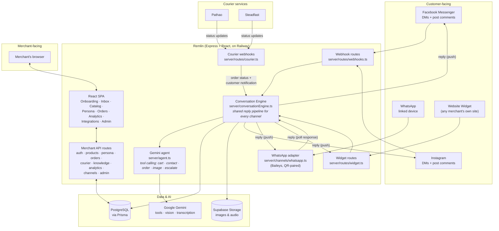
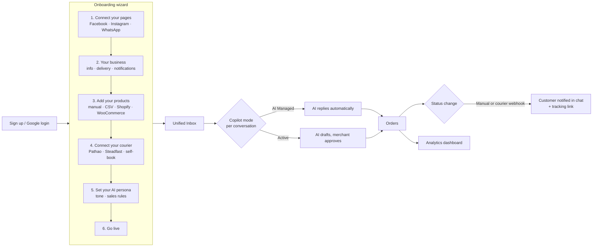

# Remlin

**An AI sales agent for online merchants.** Remlin connects to Facebook
Messenger, Instagram, WhatsApp, and a website chat widget, answers customers
in English, Bangla, or Banglish using the store's real product catalog and
knowledge base, and manages carts, orders, and courier dispatch end to end.

Built as a CSE499 capstone project.

[](./LICENSE)
[](https://remlin.up.railway.app)

## Table of Contents

- [Live Site](#live-site)
- [Features](#features)
- [Tech Stack](#tech-stack)
- [Architecture](#architecture)
- [How a Customer Message Gets Answered](#how-a-customer-message-gets-answered)
- [Merchant Journey](#merchant-journey)
- [Project Structure](#project-structure)
- [Getting Started](#getting-started)
- [Scripts](#scripts)
- [Testing](#testing)
- [Deployment](#deployment)
- [Security](#security)
- [Documentation](#documentation)
- [License](#license)

## Live Site

The deployed app is live on Railway: [remlin.up.railway.app](https://remlin.up.railway.app)

## Features

### Sales channels

- **Facebook Messenger** — self-serve Meta OAuth connect; DMs and automatic
  replies to public post comments, pivoting commenters into DM.
- **Instagram** — same Meta OAuth flow; DMs and comment auto-replies.
- **WhatsApp** — linked-device session via QR scan (Baileys); pairing survives
  restarts and redeploys.
- **Website chat widget** — a script tag any merchant embeds on their own site;
  returning visitors are matched back to their conversation by a stored
  visitor ID, scoped to the store's `widgetKey`.

### The AI agent

- **Tool calling, not a JSON blob** — the agent calls explicit tools
  (`add_to_cart`, `ask_for_quantity`, `capture_contact_details`,
  `request_order_confirmation`, `confirm_order`, `cancel_order`,
  `show_product_image`, `flag_for_human_review`) and the backend validates and
  executes each one against real inventory and order state.
- **Product photo recognition** — a customer can send a picture of what they
  want; Gemini visually matches it against the store's own catalog images
  through an exact / ambiguous / no-match flow that never guesses on ambiguous
  matches.
- **Voice messages** — inbound audio is validated by magic bytes, transcribed,
  and answered like a normal text message.
- **Multilingual** — replies follow the customer's own language: English,
  Bangla, or Banglish.
- **Grounding guardrail** — every price in a generated reply is checked against
  the numbers actually given to the model that turn; ungrounded replies are
  retried once, then replaced with a safe template and flagged.
- **Real orders** — a confirmed purchase becomes an `Order` row: automatically
  in AI-Managed conversations, or as a draft awaiting merchant approval in
  Active (Copilot-review) mode.
- **Knowledge base** — free-form merchant documents (shipping policies, FAQs,
  return rules) the agent grounds its answers on.

### Orders and courier dispatch

- **Order lifecycle** — Processing → Ready to ship → In transit → Out for
  delivery → Delivered, plus Delivery failed and Cancelled. Merchants can set
  any status by hand; courier webhooks only ever move orders forward.
- **Courier integrations** — merchants connect Pathao or Steadfast with their
  panel credentials (encrypted at rest), or choose "I'll book parcels myself".
- **Automatic status sync** — each store gets a unique webhook address and
  token (`/api/courier/webhook/<provider>/<token>`); Pathao and Steadfast
  events move orders forward automatically, matching by order reference or
  tracking code.
- **Customer notifications** — merchants tick which status changes message the
  customer; the update is delivered as an AI message in the customer's chat
  (with the courier tracking link for In transit), respecting the 24-hour
  messaging window.

### Merchant dashboard

- **Guided onboarding** — a six-step wizard: Connect your pages → Your
  business → Add your products → Connect your courier → Set your AI persona →
  Go live, with progress tracking and gated steps.
- **Unified inbox** — every channel in one thread list; per-conversation
  Copilot toggle (AI Managed autopilot vs. Active draft-review), archive/spam
  filters, cart and order panels.
- **Analytics** — real metrics derived from logged per-message metadata:
  messages handled, AI vs. human reply split, conversations the AI resolved
  alone, busiest messaging hours, median first-reply times, and handoff/SLA
  stats, over ranges from 7 days to 12 months.
- **Admin console** — platform-level merchant management.

## Tech Stack

| Layer | Technology |
|---|---|
| Frontend | React 19 + TypeScript, Vite, Tailwind CSS 4, Recharts, Motion |
| Backend | Node.js + Express, TypeScript (`tsx`) |
| Database | PostgreSQL (Supabase) via Prisma ORM |
| Media storage | Supabase Storage (product images, chat photos, voice notes) |
| AI | Google Gemini — tool calling, vision, audio transcription |
| Messaging | Meta Graph API (Messenger + Instagram), Baileys (WhatsApp linked device) |
| Catalog sync | Shopify, WooCommerce |
| Couriers | Pathao, Steadfast (webhook-driven status sync) |
| Hosting | Railway (Docker image, `/api/health` healthcheck) |

## Architecture



Every route lives in its own file under `server/routes/` — see
[`docs/`](./docs/) for the design reports and per-channel setup guides. The AI
reply pipeline is channel-agnostic: `generateAndStoreAgentReply()` in
`server/conversationEngine.ts` doesn't know or care whether it's replying to a
Messenger PSID, an Instagram user, a WhatsApp number, or an anonymous website
visitor — channel-specific code only exists in the last step, delivering the
reply back out.

## How a Customer Message Gets Answered

```mermaid
sequenceDiagram
    participant C as Customer
    participant Ch as Channel<br/>(Messenger/IG/WhatsApp/Widget)
    participant R as Route handler
    participant E as Conversation Engine
    participant AI as Gemini
    participant DB as Database

    C->>Ch: Sends a message (text, photo, or voice)
    Ch->>R: Webhook event / widget POST / Baileys event
    R->>DB: Find or create Conversation
    alt First message ever in this conversation
        R->>DB: Send store's configured opening greeting
    else Ongoing conversation
        Note over R,E: Photos are matched against catalog images;<br/>voice notes are transcribed first
        R->>E: generateAndStoreAgentReply(conversation, text)
        E->>DB: Load persona + catalog + knowledge docs + recent history
        E->>AI: Prompt + tool declarations<br/>(cart / contact / order / escalate)
        AI-->>E: Reply text + tool calls
        E->>DB: Validate tool calls & persist cart / contact / order state
        opt Customer confirmed a purchase
            E->>DB: Atomically decrement inventory, create Order
        end
        E->>DB: Save AI reply as a Message
    end
    E-->>R: Done
    R-->>Ch: Deliver reply (Graph API push, Baileys send, or widget response)
    Ch-->>C: Customer sees the reply
```

If the merchant has **Copilot** off for that conversation, the AI's reply is
saved as a *pending draft* instead of being sent — the merchant reviews and
approves it from the Inbox before the customer ever sees it.

## Merchant Journey



## Project Structure

```
├── server.ts                  # Express app entry — middleware, route mounting
├── server/
│   ├── agent.ts               # Gemini agent: prompt, tool declarations, loop
│   ├── conversationEngine.ts  # Channel-agnostic reply pipeline
│   ├── courierWebhooks.ts     # Pathao/Steadfast event parsing → order updates
│   ├── businessProfile.ts     # Business profile → AI instruction context
│   ├── crypto.ts              # AES-256-GCM for stored channel/courier secrets
│   ├── channels/whatsapp.ts   # Baileys linked-device adapter
│   └── routes/                # One file per API surface (auth, orders,
│                              #   courier, products, persona, webhooks, ...)
├── src/
│   ├── App.tsx                # Hash-based routing, auth & profile gates
│   ├── components/            # OnboardingPage, InboxConsole, OrdersPage,
│   │                          #   AnalyticsDashboard, CourierStep, ...
│   └── lib/api.ts             # Typed API client
├── shared/                    # Types/constants shared by client and server
├── prisma/
│   ├── schema.prisma          # Data model
│   └── migrations/            # Migration history
├── public/widget.js           # Embeddable customer chat widget
├── scripts/                   # Smoke tests, eval harness, one-off backfills
└── docs/                      # Design reports, setup guides, eval results
```

## Getting Started

**Prerequisites:** Node.js, a Postgres database (Supabase works), and a Gemini
API key.

1. **Install dependencies**

   ```bash
   npm install
   ```

2. **Configure environment** — copy `.env.example` to `.env` and fill in the
   required values:

   | Variable | Required | Purpose |
   |---|---|---|
   | `GEMINI_API_KEY` | Yes | Google Gemini (aistudio.google.com/apikey) |
   | `DATABASE_URL` | Yes | Pooled Postgres connection (app runtime) |
   | `DIRECT_URL` | Yes | Direct Postgres connection (migrations) |
   | `JWT_SECRET` | Yes | Auth token signing |
   | `APP_URL` | Production | Public base URL — OAuth callbacks, courier webhooks |
   | `CHANNEL_ENCRYPTION_KEY` | Channels | 32-byte hex key for stored secrets |
   | `FACEBOOK_APP_ID` + `META_*` | FB/IG | Meta OAuth + webhook verification |
   | `GOOGLE_CLIENT_ID` + `GOOGLE_CLIENT_SECRET` | Google login | Merchant sign-in |
   | `SUPABASE_URL` + `SUPABASE_SERVICE_ROLE_KEY` | Media | Storage for images/audio |

3. **Seed a demo store** *(optional)*

   ```bash
   npm run db:seed
   ```

4. **Run the app**

   ```bash
   npm run dev
   ```

   Applies pending Prisma migrations, then serves the API and the Vite dev
   server from one process.

### Connecting channels

- **WhatsApp** — scan a QR code from the Integrations page. It's a WhatsApp
  Web linked-device session; auth keys live in the database so pairing
  survives restarts and redeploys. Run a single instance.
- **Facebook / Instagram** — self-serve Meta OAuth; see `.env.example` for the
  required app settings.
- **Website widget** — works out of the box: embed `public/widget.js` on any
  page with the store's `widgetKey`.
- **Shopify / WooCommerce** — sync the product catalog rather than messages.
- **Couriers** — onboarding generates the webhook address and token
  automatically; paste them into the courier's panel so delivery events update
  orders. Set `APP_URL` to a public URL first — couriers can't reach
  `localhost`.

## Scripts

| Command | Description |
|---|---|
| `npm run dev` | Apply migrations, run server + Vite dev server |
| `npm run build` | Build frontend (Vite) and bundle server (esbuild) |
| `npm start` | Run the production bundle from `dist/` |
| `npm run lint` | Typecheck (`tsc --noEmit`) |
| `npm run db:seed` | Seed a demo store |
| `npm run test:image` | Image-recognition smoke test |
| `npm run test:knowledge` | Knowledge-base smoke test |

## Testing

`scripts/` holds smoke checks that exercise the image-recognition,
knowledge-base, and input-validation paths without external services, plus
`scripts/eval/` — a 50-case evaluation harness for the agent's intent, SKU,
and complaint accuracy across English/Bangla/Banglish (results in
[`docs/EVAL_RESULTS.md`](./docs/EVAL_RESULTS.md)).

## Deployment

Push the repo or run `railway up`, paste the `.env` values into the service
variables, and deploy — the `Dockerfile` builds the Vite frontend and bundles
the server, `railway.json` sets the `/api/health` healthcheck, and
`prisma migrate deploy` runs on boot.

## Security

- JWT sessions + bcrypt password hashing; Google OAuth sign-in; OAuth handoffs
  use short-lived opaque codes so tokens never touch browser history.
- Channel and courier credentials (Meta tokens, WhatsApp keys, Pathao /
  Steadfast secrets) encrypted at rest with AES-256-GCM.
- Meta webhook signature verification plus idempotency ledgers
  (`Message.externalId`, `WebhookEvent`) so redelivered events can't trigger
  duplicate replies or sends.
- Per-store random webhook tokens on courier endpoints.
- Helmet headers, per-endpoint rate limiting, a trusted-origin check on
  state-changing requests, and centralized input/media validation (magic-byte
  checks on images and audio).

## Documentation

Project docs live in [`docs/`](./docs/) — architecture notes, the AI agent's
order-management rules, the tool-calling migration guide, the UI design spec,
per-channel setup guides (Shopify, WooCommerce, WhatsApp, Facebook), the eval
results, and the capstone course-outcome submission documents.

## License

MIT — see [LICENSE](./LICENSE).
